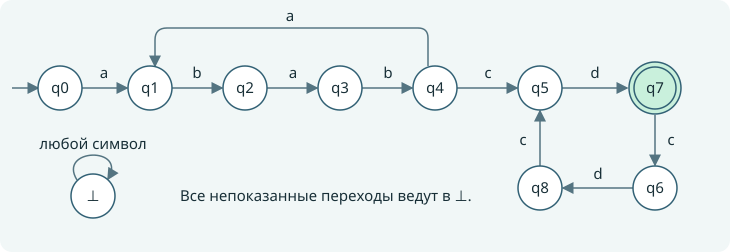

# Лабораторная работа №1. Конечный автомат для распознавания формальных языков

| Параметр | Значение |
| --- | --- |
| Студент | Максим Орлов |
| Группа | IA-2404 |
| Вариант | 11 |

[Условие в Moodle](https://elearning.usm.md/mod/assign/view.php?id=337250)

## Цель

Построить детерминированный конечный автомат, который последовательно читает входное слово и определяет, принадлежит ли оно заданному языку.

## Постановка

Алфавит Σ = {a, b, c, d}. Язык содержит слова вида `(ab)ⁿ(cd)ᵐ`, где n ≥ 2, m ≥ 1, n чётное, а m нечётное. Поэтому эквивалентная запись языка имеет вид `(abab)⁺cd(cdcd)*`. Пустое слово отклоняется. Символы вне алфавита, включая пробелы и буквы другого регистра, отклоняются без изменения ввода.

Автомат задаётся пятёркой (Q, Σ, δ, q0, F). Множество состояний Q = {q0, q1, q2, q3, q4, q5, q6, q7, q8, ⊥}. Стартовое состояние q0. Принимающее множество F = {q7}.

## Диаграмма автомата



Двойным кругом обозначено принимающее состояние. Любой переход, отсутствующий на диаграмме, ведёт в поглощающее состояние ⊥.

| Состояние | Что уже прочитано | a | b | c | d |
| --- | --- | --- | --- | --- | --- |
| → q0 | Пустой префикс | q1 | ⊥ | ⊥ | ⊥ |
| q1 | Чётное число блоков ab и начало следующего блока | ⊥ | q2 | ⊥ | ⊥ |
| q2 | Нечётное число полных блоков ab | q3 | ⊥ | ⊥ | ⊥ |
| q3 | Нечётное число блоков ab и начало следующего блока | ⊥ | q4 | ⊥ | ⊥ |
| q4 | Положительное чётное число полных блоков ab | q1 | ⊥ | q5 | ⊥ |
| q5 | Чётное число блоков cd, включая ноль, и начало следующего блока | ⊥ | ⊥ | ⊥ | q7 |
| q6 | Нечётное число блоков cd и начало следующего блока | ⊥ | ⊥ | ⊥ | q8 |
| ★ q7 | Нечётное число полных блоков cd | ⊥ | ⊥ | q6 | ⊥ |
| q8 | Положительное чётное число полных блоков cd | ⊥ | ⊥ | q5 | ⊥ |
| ⊥ | Обнаружен недопустимый символ или порядок символов | ⊥ | ⊥ | ⊥ | ⊥ |

Во всех состояниях q5-q8 уже прочитано положительное чётное число полных блоков ab. Из q0 в q4 впервые можно попасть только после `abab`. Каждый следующий оборот из q4 обратно в q4 добавляет ещё два блока `ab`. Первый `cd` переводит автомат из q4 в q7, а каждый оборот из q7 обратно в q7 добавляет два блока `cd`. Поэтому любое принятое слово удовлетворяет условию. В обратную сторону любое слово с нужными n и m проходит именно эти переходы и заканчивается в q7.

## Реализация и запуск

Скачайте ZIP через **Code → Download ZIP**, распакуйте его и откройте `lab-01/index.html` в браузере. Интернет и установка пакетов для работы страницы не требуются. Введите слово или выберите готовый пример. Программа выводит решение, конечное состояние и трассу. Для длинных слов интерфейс отображает первые 250 переходов, а автомат проверяет ввод полностью.

[Модель автомата](model.js) хранит таблицу переходов. Для каждой позиции алгоритм получает следующее состояние из текущего состояния и очередного символа. В конце он принимает слово, только если итоговое состояние равно q7. Модель работает за O(k) времени и O(1) дополнительной памяти, где k - длина входа. Построение экранной трассы ограничено 250 строками.

Для минимального допустимого слова:

```text
ababcd: q0 → q1 → q2 → q3 → q4 → q5 → q7
```

## Верификация

| Вход | Результат | Причина |
| --- | --- | --- |
| `ababcd` | Принято | Минимальные n = 2 и m = 1 |
| `ababababcd` | Принято | n = 4, m = 1 |
| `ababcdcdcd` | Принято | n = 2, m = 3 |
| Пустое слово | Отклонено | q0 не принимающее |
| `cd` | Отклонено | Нет блоков ab |
| `abcd` | Отклонено | n = 1 |
| `abababcd` | Отклонено | n = 3 |
| `abab` | Отклонено | Нет блоков cd |
| `ababc` | Отклонено | Последний блок неполный |
| `ababcdcd` | Отклонено | m = 2 |
| `ababcdab` | Отклонено | Блок ab после начала фазы cd |
| `abab cd` | Отклонено | Пробел вне алфавита |

Команда `node lab-01/test.js` из корня репозитория запускает [тесты](test.js) без установки пакетов. Проверены 18 именованных случаев и все 1 398 101 слово над Σ длиной от 0 до 10. Результаты каждого из этих слов совпали с независимой проверкой структуры и числа пар. Дополнительно проверены полнота переходов, точная трасса минимального слова и два входа длиной более 60 000 символов.

## Вывод

Один проход по входу достаточен, потому что для решения нужно помнить только фазу, позицию внутри пары и чётность числа завершённых пар. Отдельное принимающее состояние q7 исключает неполные блоки и чётное число повторений cd.
