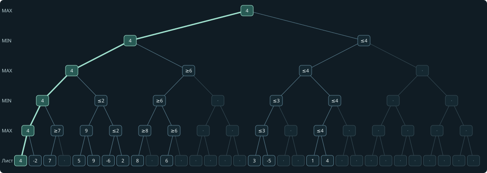

# Лабораторная работа №2. Мини-макс с альфа-бета отсечением

| Параметр | Значение |
| --- | --- |
| Вариант | №1. Бинарное дерево с фиксированными оценками |
| Студент | Максим Орлов |
| Группа | IA-2404 |
| Дата | 25.11.2026 |

[Отчёт PDF](Report-Lab-02.pdf?raw=true) · [Условие в Moodle](https://elearning.usm.md/mod/assign/view.php?id=337251)

## Запуск

Скачайте ZIP через **Code → Download ZIP**, распакуйте его и откройте `lab-02/index.html`. Интернет и установка пакетов не требуются. Выберите роль MAX или MIN, затем выбирайте левую или правую ветвь. Компьютер играет за вторую сторону и рассчитывает лучший ход отдельно для текущей позиции. В конце показывается оценка достигнутого листа.

## Модель

Глубина дерева составляет пять рёбер от корня до листа. На глубинах 0, 2 и 4 ходит MAX, на глубинах 1 и 3 ходит MIN. У каждого внутреннего узла два потомка. В дереве 63 узла, включая 32 листа. Листовые оценки фиксированы, приведены слева направо:

```text
 4 -2  7  3   5  9 -6  2   8  1  6  0   2 -3  4  7
 3 -5  0  8   1  4 -2  6   5  2  9  1  -4  7  3  6
```

## Алгоритмы

Обычный мини-макс рекурсивно обходит всё дерево. В листе он возвращает заданную оценку. Внутренний узел MAX берёт максимум оценок потомков, а MIN берёт минимум.

Второй режим применяет ту же рекурсию с границами α и β. Из корня запускается с α = −∞ и β = +∞. На ходе MAX обновляется α, на ходе MIN обновляется β. Как только α ≥ β, неизученную ветвь можно пропустить, поскольку она уже не изменит решение предка. На диаграмме оценки внутренних узлов, полученные с ограниченным окном, могут быть показаны как верхняя или нижняя граница.

## Эксперимент

Оба режима запускались на одинаковых листовых оценках. Посещения включают внутренние узлы и листья. Время дано в микросекундах на один запуск. Сначала выполнен прогрев, затем рассчитана медиана по девяти сериям по 2000 вызовов каждого режима. Значения времени зависят от среды. Можно повторить расчёт кнопкой **Измерить время** или командой `node lab-02/verify.js`.

| Порядок обхода | Метод | Оценка | Узлы | Листья | Отсечения | мкс / запуск |
| --- | --- | ---: | ---: | ---: | ---: | ---: |
| Слева направо | Мини-макс | 4 | 63 | 32 | 0 | 2,78 |
| Слева направо | С отсечением | 4 | 32 | 13 | 7 | 1,78 |
| Справа налево | Мини-макс | 4 | 63 | 32 | 0 | 2,87 |
| Справа налево | С отсечением | 4 | 57 | 27 | 4 | 2,87 |



Зелёная линия отмечает оптимальный путь при обходе слева направо. Точки обозначают узлы, которые поиск пропустил. Обход справа налево может выбрать другой равноценный путь.

## Проверка и вывод

Оценки обоих алгоритмов сверены с независимым расчётом снизу вверх для всех 63 стартовых узлов и двух порядков обхода. Также проверены длины оптимальных путей, границы оценок и условия отсечения.

В обоих порядках оптимальная оценка корня равна 4. При обходе слева направо отсечение сократило число посещений с 63 до 32, то есть на 49,2%. При обратном обходе сокращение составило 9,5%. На таком небольшом дереве время зависит от накладных расходов, поэтому число посещений лучше показывает эффект порядка обхода.

[Исходный код алгоритмов](model.js) · [Проверка и измерения](verify.js)
