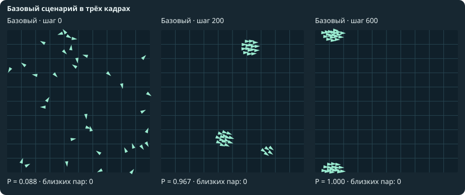
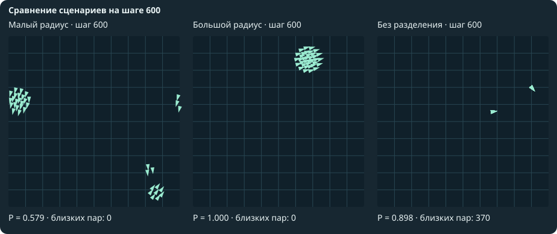

# Лабораторная работа №3. Моделирование коллективного поведения агентов

| Параметр | Значение |
| --- | --- |
| Вариант | №1. Моделирование движения стаи птиц в 2D-пространстве |
| Студент | Максим Орлов |
| Группа | IA-2404 |
| Дата выполнения | 25.11.2026 |

[Отчёт PDF](Report-Lab-03.pdf?raw=true) · [Условие в Moodle](https://elearning.usm.md/mod/assign/view.php?id=341567)

## Запуск

Скачайте архив через **Code → Download ZIP**, распакуйте его и откройте `lab-03/index.html` в браузере. HTML-демонстрация работает без установки и интернета. Параметры меняются ползунками, готовые наборы доступны в списке сценариев. Кнопки дают поставить движение на паузу и повторить запуск.

Для просмотра в Pygame установите зависимости командой `python -m pip install -r lab-03/requirements.txt` и запустите `python lab-03/pygame_viewer.py --scenario base`. Просмотрщик использует Node.js для получения 601 кадра, включая начальное состояние. Пробел переключает паузу, R запускает сценарий сначала.

## Цель работы

Реализовать модель коллективного движения птиц по правилам Крейга Рейнольдса и выяснить, как радиус соседства и веса правил меняют согласованность движения и плотность стаи.

## Описание модели

На плоскости 100 × 100 движутся 36 птиц. Каждая имеет координаты (x, y) и скорость (vx, vy). Начальные позиции, направления и модули скорости получают из генератора с seed 42. Все эксперименты начинаются с одного и того же состояния. Размер, количество агентов и пределы заданы в `defaults`. Предел скорости составляет 1,35 единицы за шаг, предел ускорения - 0,30 единицы за шаг².

Границы периодические. При выходе вправо птица появляется слева, аналогично для верхнего и нижнего края. При поиске соседей тоже используется периодическое расстояние. Например, точки x = 1 и x = 99 при одинаковой y разделены двумя единицами. Модель предполагает круговую зону обзора без слепого сектора и точечных агентов. Пара ближе одной единицы считается близкой, это показатель риска столкновений.

## Алгоритм

1. Для каждой птицы найти соседей в радиусе R по кратчайшему смещению между точками на периодическом поле.
2. Рассчитать центрирование как среднее смещение до соседей. Выравнивание равно разности средней скорости соседей и собственной скорости. Разделение суммирует направления от птиц ближе четырёх единиц с коэффициентом 1 − d/4. При точном совпадении позиций для пары используются противоположные направления.
3. Сложить три вектора с весами. Ограничить модуль ускорения, прибавить ускорение к скорости и ограничить её модуль.
4. Перенести птицу согласно новой скорости и применить периодические границы. Для расчёта всех птиц использовать одно предыдущее состояние, затем одновременно заменить состояния.

## Реализация

`model.js` содержит параметры, генерацию начального состояния, расчёт сил, обновление и измерение показателей. `app.js` показывает модель через Canvas 2D, обновляя позиции на каждом шаге. Node.js запускает те же функции для воспроизводимых экспериментов и сохраняет результаты в CSV и кадры в SVG. Просмотрщик `pygame_viewer.py` отображает кадры того же алгоритма. Один шаг прямого перебора соседей занимает O(N²).

## Кадры симуляции

В начале направления и позиции птиц различаются. Затем птицы группируются и выравнивают направления. Треугольники показывают положение и направление движения каждой птицы.

На малом радиусе заметны несколько групп. Без разделения многие птицы занимают почти совпадающие позиции, поэтому часть треугольников перекрывается.

## Эксперименты

Каждый сценарий выполнен на 600 шагах. В таблице средние за шаги 401-600. Поляризация P - длина среднего единичного вектора скорости. Значение около 1 соответствует общему направлению, около 0 - разнонаправленному движению. Расстояние - среднее расстояние до ближайшего соседа. Близкие пары считаются один раз при расстоянии менее одной единицы.

| Сценарий | R | Центр. | Выр. | Разд. | P | Расстояние | Близкие пары |
| --- | ---: | ---: | ---: | ---: | ---: | ---: | ---: |
| Базовый | 18 | 0,01 | 0,05 | 0,10 | 0,998 | 2,058 | 0,000 |
| Малый радиус | 8 | 0,01 | 0,05 | 0,10 | 0,415 | 2,693 | 0,000 |
| Большой радиус | 30 | 0,01 | 0,05 | 0,10 | 1,000 | 2,080 | 0,000 |
| Сильное выравнивание | 18 | 0,01 | 0,20 | 0,10 | 0,998 | 2,411 | 0,000 |
| Сильное центрирование | 18 | 0,04 | 0,05 | 0,10 | 0,481 | 1,497 | 2,790 |
| Без разделения | 18 | 0,01 | 0,05 | 0,00 | 0,898 | 0,000¹ | 370,000 |

¹ После округления до трёх знаков.

Повторить эксперимент из корня проекта можно командой `node lab-03/experiments.js`. Она также проверяет наличие 36 агентов на каждом шаге, ограничения координат и скорости и взаимодействие через границу. [Результаты измерений в CSV](results.csv)

## Выводы

При малом радиусе локальные группы двигались в разных направлениях, поэтому общая поляризация снизилась с 0,998 до 0,415. Увеличение радиуса до 30 позволило птицам двигаться практически параллельно. Усиление выравнивания сохранило общую направленность, при этом расстояние до ближайшего соседа выросло с 2,058 до 2,411. Усиление центрирования сделало группы плотнее и добавило близкие сближения. Без разделения модель дала в среднем 370 близких пар на шаг. Эти результаты относятся к выбранным начальному состоянию и параметрам.
